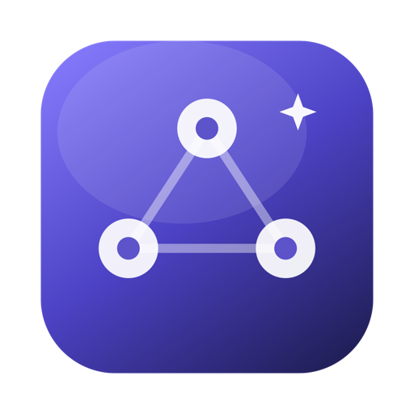
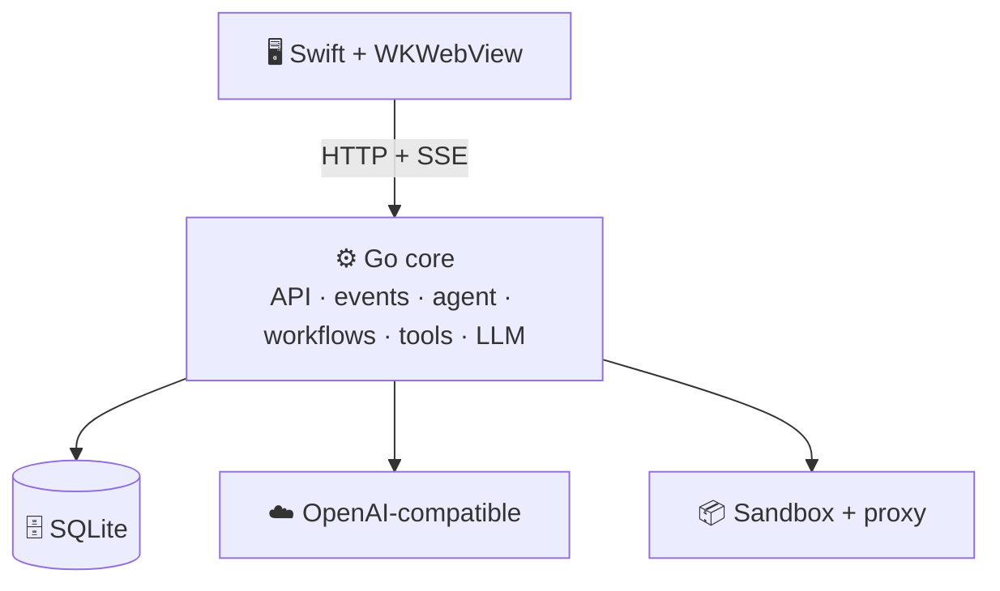

<p align="center">
  
</p>

<h1 align="center">MyAgent</h1>

<p align="center">
  <strong>Your Mac. Your models. Your agent.</strong><br />
  A local-first macOS agent that chats, uses tools, builds workflows and improves from every run.
</p>

<p align="center">
  
  
  
  
  
  
  
</p>

---

MyAgent is a native macOS app with a Go core. The database, tools, secrets, workflow engine, traces and model gateway all run locally. No cloud account, no background SaaS, no hidden execution path.

## 💡 Why MyAgent?

- 🛡️ **Approval first** — writes, external actions and first runs wait for you.
- ♻️ **Reusable by design** — a successful chat becomes a versioned workflow; a missing capability becomes a versioned tool.
- 🔍 **Observable** — every state change is a persisted event; runs, traces, cost and eval replay share one source of truth.
- 🧠 **Bring your own model** — any OpenAI Chat Completions-compatible endpoint works, including local runtimes.

## 🚀 Quick start

**Requirements:** macOS 13+, [mise](https://mise.jdx.dev/), Xcode Command Line Tools.

```bash
mise install       # Go 1.27.3 + Node 26.12.1 + pnpm 12.16.1
mise run deps      # install UI dependencies
mise run dev       # Go core + Vite with HMR
```

The dev command prints a loopback URL with a session token. Vite proxies `/api` to the Go core.

### 🖥️ Native app

```bash
mise run app
open dist/MyAgent.app
```

Closing the window quits the app and stops the core. Scheduled and watched runs only execute while the app is open.

### 📁 First run

| Item | Value |
| --- | --- |
| 📁 Data | `~/Library/Application Support/MyAgent` |
| 🗂️ Workspace | `~/MyAgent` |
| 🔑 Overrides | `MYAGENT_DATA_DIR`, `MYAGENT_WORKSPACE` |

Existing installs using `~/MyAgent Workspace` migrate on the next launch.

> [!TIP]
> A fresh install starts with built-in tools only. Add a model in **Settings → Models** to use chat. Workflows, conversations and workspace files are created by you.

## ✨ What's inside

| | Area | Highlights |
| --- | --- | --- |
| 💬 | **Chat agent** | Streaming markdown, tool cards, approvals, live step/token limits, rename/auto-name, stop, run links and “Save as workflow”. |
| 🔁 | **Workflows** | Strict YAML, structured validator, DAG engine, parallel/map/branch/agent steps, retries, pause/resume and crash recovery. |
| 🎨 | **Canvas** | Live React Flow graph, status colors, animated edges and a per-step inspector for input, output, logs, trace and cost. |
| 🧰 | **Tools** | Built-ins, Starlark, Python/Node/shell/binary sandbox, manifests, tests, version lifecycle and structured result rendering. |
| 🛡️ | **Safety** | AES-256-GCM secrets, master key outside SQLite, redaction everywhere, path checks and a loopback-only API. |
| 📊 | **Runs** | History, filters, feedback, rerun, side-by-side comparison and resumable interrupted runs. |
| 🎯 | **Tuning** | Eval suites from real runs, deterministic replay, tuner diagnosis, diff review and rollback. |
| ⏰ | **Triggers** | Cron, folder watchers, local webhooks, CLI, unattended policies and concurrency policies. |
| 🖥️ | **Desktop** | Native Swift/WebKit shell, Geist Mono, adjustable text size, Light/Dark/System appearance and Sparkle auto-update. |

## 🧠 Models

Any OpenAI-compatible endpoint works: OpenAI, OpenRouter, Ollama, LM Studio, vLLM, Groq, DeepSeek and more.

| Provider | Base URL |
| --- | --- |
| 🟢 OpenAI | `https://api.openai.com/v1` |
| 🔀 OpenRouter | `https://openrouter.ai/api/v1` |
| ⚡ OpenCode Go | `https://opencode.ai/zen/go/v1` |
| 🦙 Ollama | `http://127.0.0.1:11434/v1` |
| 🖥️ LM Studio | `http://127.0.0.1:1234/v1` |
| 🐋 DeepSeek | `https://api.deepseek.com/v1` |
| 🚀 Groq | `https://api.groq.com/openai/v1` |

> [!NOTE]
> **OpenCode Go** sends `x-opencode-session` with a stable per-conversation UUID (chat) or per-run UUID (workflow). The value is never a shared static session. For other gateways, set a custom **Session header** in the model profile.

Model roles: `planner`, `executor`, `judge`, `cheap`. Probe a profile to verify streaming and tool calling before using it for workflow authoring.

## 🛠️ Tasks

All commands live in `.mise.toml`.

| | Task | Purpose |
| --- | --- | --- |
| 📥 | `mise run deps` | Install UI dependencies |
| 🧑‍💻 | `mise run dev` | Go core + Vite HMR |
| 🎨 | `mise run ui` | Build production UI |
| ⚙️ | `mise run api` | Build `agentd` and `agentctl` |
| 🏗️ | `mise run build` | Build UI and Go binaries |
| ✨ | `mise run format` | Format Go with gofmt and golines |
| 🔎 | `mise run format-check` | Check Go formatting without writing |
| ▶️ | `mise run run` | Serve production UI on `127.0.0.1:8787` |
| 📱 | `mise run app` | Build `dist/MyAgent.app` |
| 📲 | `mise run install` | Build and install into `/Applications` |
| 🔏 | `mise run sign-setup` | Create a local self-signed signing identity |
| 📥 | `mise run sign-import` | Import a self-signed identity from a `.p12` |
| 🪪 | `mise run sign-status` | Show the local signing identity |
| 🚀 | `mise run release` | Package a macOS release zip and appcast |
| 🔑 | `mise run sparkle-key` | Print the Sparkle EdDSA public key |
| 🔐 | `mise run sparkle-export` | Export the Sparkle private key for CI |
| 📥 | `mise run sparkle-import` | Import the Sparkle private key from a file |
| 🧪 | `mise run test` | Go tests + UI typecheck |
| 🎭 | `mise run e2e` | Playwright smoke tests |
| 🧹 | `mise run clean` | Remove build output and local data (keeps `dist/signing`) |

## 💻 CLI

```bash
bin/agentctl workflows
bin/agentctl run workspace-digest --input folder=. --input output=digests/digest.md
bin/agentctl runs --limit 10
bin/agentctl status <run-id>
bin/agentctl cancel <run-id>
bin/agentctl tools
```

`agentctl` reads the loopback URL and session token from `<data-dir>/api.json` (`0600`) and talks to the same local API as the UI.

## 🏗️ Architecture



The shell is intentionally thin. The Go core has no WebKit dependency and runs headless with `agentd` + `agentctl`.

<details>
<summary>📂 Repository map</summary>

```text
internal/app        agent loop, meta-tools, chat, runs, triggers
internal/llm        OpenAI-compatible gateway, probe, cost
internal/workflow   schema, validator, expressions, DAG engine
internal/tools      registry, builtins, Starlark/script sandbox, proxy
internal/store      SQLite schema and queries
internal/eventbus   persisted events + live fan-out
internal/secrets    AES-GCM store, key providers, redaction
internal/api        HTTP/SSE handlers
internal/schema     JSON Schema validation
app/                Swift native shell + Info.plist + icon
ui/                 React + TypeScript + Vite + React Flow
cmd/agentd          local core server
cmd/agentctl        CLI
```

</details>

## 🔐 Security

| | Layer | Guarantee |
| --- | --- | --- |
| 🔑 | **Secrets** | AES-256-GCM encrypted in SQLite; master key in Keychain or a `0600` dev file. |
| 🫥 | **Redaction** | Raw, URL-encoded and base64 forms across events, logs, tool output, artifacts and model I/O. |
| ✅ | **Approvals** | Required for writes, external actions, new tools, version changes and trigger creation; tied to the content hash. |
| 📁 | **Filesystem** | Symlinks resolved; tools stay inside the workspace. |
| 📦 | **Subprocess** | `sandbox-exec`; app data directory and common credential stores denied. |
| 🌐 | **Network** | Loopback HTTP/CONNECT proxy, domain allowlists, private-IP blocking and header-secret injection. |
| 🔌 | **API** | Loopback only; per-launch token or SameSite cookie; webhook triggers use their own token. |

## 📦 Release

```bash
VERSION=v1.0.0 mise run release
```

Artifacts go to `dist/release/` as a zip, SHA-256 and Sparkle `appcast.xml`. The GitHub workflow builds on `macos-14` for `v*` tags and publishes the release. The tag name (for example `v0.1.6`) is written to `CFBundleShortVersionString` and injected into the Go core, so the in-app version matches the release.

### 🔏 Local signing (self-signed)

Local builds use a stable self-signed code signing identity so macOS keeps permissions (Local Network, firewall, TCC, login items) across updates. Run once per Mac:

```bash
mise run sign-setup
```

This creates `MyAgent Self-Signed`, trusts it for code signing in your login keychain, and exports `dist/signing/MyAgent-SelfSigned.p12`. Copy that file to the second Mac, then import it there:

```bash
mise run sign-import -- /path/to/MyAgent-SelfSigned.p12
```

Both Macs must use the same identity, otherwise permissions reset. Keep the `.p12` and its password safe (a password manager or encrypted disk); `mise run clean` keeps `dist/signing/`, but other cleanups may not.

To sign GitHub Actions releases with the same identity, add the base64-encoded `.p12` and its password as the `MACOS_CERT_P12` and `MACOS_CERT_PASSWORD` repository secrets:

```bash
base64 -i dist/signing/MyAgent-SelfSigned.p12 | pbcopy
```

Without those secrets, CI builds remain ad-hoc signed. On hosted runners the workflow trusts the certificate in the System keychain with `sudo`, because user-domain trust prompts require a GUI session that CI does not have.

Check the active identity:

```bash
mise run sign-status
```

Then build and install:

```bash
mise run install
```

`install` builds the app, copies it to `/Applications`, removes the quarantine bit, and launches it. The first manual install on a new Mac may still show a Gatekeeper warning because a self-signed app is not notarized; approve it once in **System Settings → Privacy & Security → Open Anyway** (or run `xattr -dr com.apple.quarantine /Applications/MyAgent.app`). Sparkle updates keep the same identity and do not trigger Gatekeeper again.

Public distribution still needs Developer ID signing and notarization; self-signed builds are for your own machines.

### 🔄 Auto-update

MyAgent uses **Sparkle 2**. The app checks GitHub Releases once per day and exposes **Check for Updates…** in the app menu.

- Updates are EdDSA-signed, so auto-update works without an Apple Developer account.
- The feed is `https://github.com/0m3kk/MyAgent/releases/latest/download/appcast.xml`.
- Local releases use the Sparkle key in the macOS Keychain under the `com.myagent.desktop` account.
- GitHub Actions needs the `SPARKLE_PRIVATE_KEY` secret. Run `mise run sparkle-export`, add the contents to the repository secret, then delete the local file.
- The self-signed identity keeps permissions stable across updates. The first install may still need **Open Anyway**; later Sparkle updates do not re-trigger Gatekeeper.
- If you build releases on both Macs, share the Sparkle EdDSA key too: `mise run sparkle-export -- /path/to/key` on the first Mac, then `mise run sparkle-import -- /path/to/key` on the second. Otherwise each Mac signs appcasts with a different key and the app rejects the other's updates.

## 🧪 Tests

```bash
mise run test      # Go tests + UI typecheck
mise run e2e       # Playwright smoke tests
```

Coverage includes schema and expression validation, workflow DAG execution (retry, approval, resume), AES-GCM secrets and redaction, tool manifests and Starlark execution, proxy allowlists and mocks, LLM SSE streaming and tool calls, plus an end-to-end approval flow.

CI runs formatting checks, tests, Playwright e2e and a native app build on every push to `main` via `.github/workflows/ci.yml`.

## 🤖 Dependency updates

Dependabot checks Go modules, UI pnpm packages and GitHub Actions every Monday at 06:00 (Asia/Ho_Chi_Minh), and opens one grouped pull request per week.

## 🗺️ Status

| ✅ Implemented | 🚧 Not yet |
| --- | --- |
| Chat agent and tool loop | MCP server client and import UI |
| Workflow authoring, engine, canvas and history | OAuth refresh and `op://` 1Password references |
| Tool authoring, testing, sandbox and versioning | Developer ID signing and notarization |
| Secrets, redaction, models and probes | Windows/Linux, multi-user and cloud sync |
| Manual, scheduled, watched, webhook and CLI runs | HTTPS MITM header injection for script traffic |
| Eval replay and tuning | Menubar or login-item background agent |
| Native app, CLI and auto-update | Automatic retention/compaction for old events and artifacts |

---

<p align="center">
  <sub>Built for macOS · <a href="DESIGN.md">Design and roadmap</a></sub>
</p>
